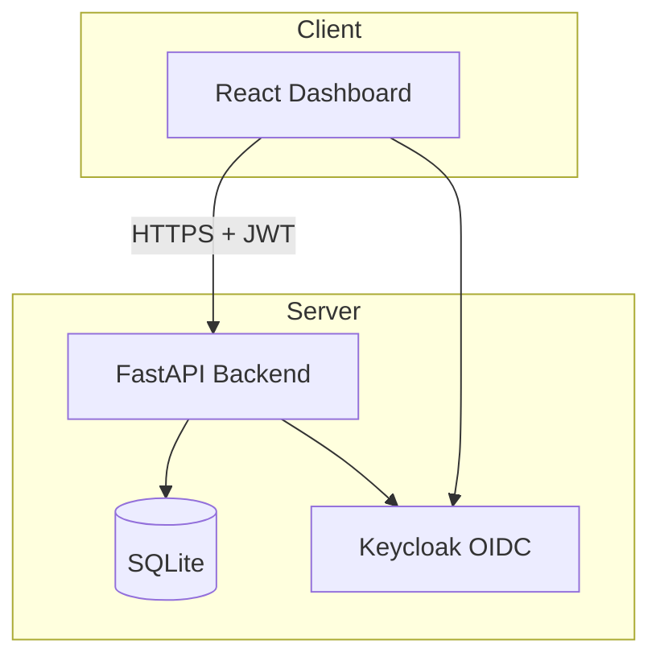

# Cobalt Console

> Work in progress. This checkpoint may be incomplete or fail tests. See PLAN.md and STATUS.md before use.


**Ryan Vo | AI & Machine Learning**

Cobalt Console is an AI/ML developer tool for building cross-platform desktop applications with GPUI. It provides window management, touch support, animations, responsive layouts, media overlays, file attachments, and video playback capabilities — all designed for modern, polished desktop applications.

## Problem & Approach

Building GPUI desktop applications requires handling window lifecycle, touch input, responsive layouts, and media composition — infrastructure that every app rebuilds. Cobalt Console centralizes these capabilities as a managed service with a React dashboard, so developers focus on their application logic instead of UI plumbing.

**Intended users:** GPUI application developers building desktop tools, IDEs, dashboards, and media applications.

## Features

- **Window Management** — Hide, show, minimize, maximize, and track window state via REST API (addresses [Issue #3008](https://github.com/longbridge/gpui-kit/issues/3008))
- **Touch Support** — Soft keyboard triggers, long-press context menus, touch drag for sliders/dividers, responsive phone-width layouts (addresses [Issue #3310](https://github.com/longbridge/gpui-kit/issues/3310))
- **Animation System** — Fade, slide, scale, spring-based animations with configurable duration/easing and reduced motion support (addresses [Issue #2967](https://github.com/longbridge/gpui-kit/issues/2967))
- **Responsive Grid** — Fixed, flexible, and auto columns with responsive breakpoints, row/column spanning, virtualization
- **Media Overlays** — Text, icon, badge, button overlays at 9 positions with hover-revealed content
- **File Attachments** — Multi-file drag-and-drop, folder hierarchy preservation, thumbnail previews, upload progress
- **Video Player** — Play/pause/seek, timeline, fullscreen, PiP, keyboard shortcuts
- **OIDC Authentication** — Keycloak with PKCE, role-based access (admin/operator/analyst), SAML broker ready

## Architecture



## Quick Start

### Prerequisites
- Docker and Docker Compose
- Python 3.12+ (for local backend development)
- Node 24+ (for local frontend development)

### With Docker Compose (Recommended)

```bash
# Clone and enter the repository
git clone https://github.com/A220man/cobalt-console-ryan-vo.git
cd cobalt-console-ryan-vo

# Copy environment template and adjust if needed
cp .env.example .env

# Start all services
docker compose up -d

# Verify health
curl http://localhost:8000/health
# {"status":"ok","service":"cobalt-console"}

# Access dashboard
open http://localhost
```

Services:
- Frontend: http://localhost
- Backend API: http://localhost:8000
- API Docs: http://localhost:8000/docs
- Keycloak Admin: http://localhost:8080 (admin/admin)

### Local Development

**Backend:**
```bash
cd backend
python -m venv .venv
.venv/bin/pip install -r requirements.txt
.venv/bin/python -m pytest app/tests -v
.venv/bin/uvicorn app.main:app --reload
```

**Frontend:**
```bash
cd frontend
npm install
npm run dev
# Open http://localhost:5173
```

## Configuration

Create `.env` from `.env.example`:

```env
ENVIRONMENT=development
DATABASE_URL=sqlite+aiosqlite:///./cobalt.db
CORS_ORIGINS=["http://localhost:5173","http://127.0.0.1:5173"]
KEYCLOAK_URL=http://localhost:8080
KEYCLOAK_REALM=cobalt
KEYCLOAK_CLIENT_ID=cobalt-console
KEYCLOAK_CLIENT_SECRET=change-me-in-production
LLM_PROVIDER=openai-compatible
LLM_MODEL=
LLM_BASE_URL=
LLM_API_KEY=
```

## API Reference

### Health
- `GET /health` — Liveness check
- `GET /health/ready` — Readiness check

### Windows
- `POST /api/v1/windows` — Create window
- `GET /api/v1/windows` — List windows (paginated)
- `GET /api/v1/windows/{window_id}` — Get window
- `PATCH /api/v1/windows/{window_id}` — Update window
- `POST /api/v1/windows/{window_id}/hide` — Hide window
- `POST /api/v1/windows/{window_id}/show` — Show window
- `DELETE /api/v1/windows/{window_id}` — Delete window

### Window State Machine
```
visible  ──hide()──> hidden
  ^                    |
  |                    v
  <────show()─────────
```

## Testing

```bash
# Backend tests
cd backend
.venv/bin/python -m pytest app/tests -v

# Frontend tests
cd frontend
npm test
```

## AI/ML Evaluation

Cobalt Console is designed to support AI/ML workflows in GPUI applications. The window management and media overlay systems enable:

- **Agent visualization windows** — Hide/show agent reasoning panels
- **Model output overlays** — Stream tokens over media content
- **Training dashboards** — Responsive grid layouts for metrics
- **Video annotation** — Frame-accurate video player for dataset labeling

*Reproducible evaluation commands and baseline metrics will be added as the domain engine matures.*

## Security Limitations

- Demo mode uses default Keycloak credentials (admin/admin) — change in production
- SQLite is not suitable for high-concurrency production workloads — migrate to PostgreSQL
- CORS origins must be explicitly configured for production domains
- JWT validation uses Keycloak JWKS — ensure clock synchronization
- No rate limiting implemented — add reverse proxy (nginx/Traefik) for production

## Provider Configuration

| Provider | LLM_PROVIDER | LLM_BASE_URL | Notes |
|----------|--------------|--------------|-------|
| OpenAI | openai-compatible | https://api.openai.com/v1 | Default |
| Anthropic | anthropic | https://api.anthropic.com | Messages API |
| Gemini | gemini | https://generativelanguage.googleapis.com | generateContent |
| Ollama | ollama | http://localhost:11434 | Local models |
| LiteLLM | openai-compatible | http://localhost:4000 | Proxy for all |

## SSO/SAML Setup

Keycloak supports SAML 2.0 identity brokering:

1. Configure SAML IdP in Keycloak Admin Console → Identity Providers → Add SAML v2.0
2. Import IdP metadata or configure manually (entity ID, SSO URL, certificates)
3. Map SAML attributes to Keycloak user attributes (email, name, roles)
4. Enable "First Login Flow" to link or create local accounts
5. Test with SP-initiated and IdP-initiated flows

## Deployment

### TLS Reverse Proxy (Required for Production)

```nginx
server {
    listen 443 ssl http2;
    server_name cobalt.example.com;

    ssl_certificate /etc/letsencrypt/live/cobalt.example.com/fullchain.pem;
    ssl_certificate_key /etc/letsencrypt/live/cobalt.example.com/privkey.pem;

    location / {
        proxy_pass http://frontend:80;
        proxy_set_header Host $host;
        proxy_set_header X-Real-IP $remote_addr;
        proxy_set_header X-Forwarded-For $proxy_add_x_forwarded_for;
        proxy_set_header X-Forwarded-Proto https;
    }

    location /api/ {
        proxy_pass http://backend:8000;
        proxy_set_header Host $host;
        proxy_set_header X-Real-IP $remote_addr;
        proxy_set_header X-Forwarded-For $proxy_add_x_forwarded_for;
        proxy_set_header X-Forwarded-Proto https;
    }
}
```

### Backup/Restore

```bash
# Backup database
docker compose exec backend cp /app/data/cobalt.db /app/data/cobalt-backup-$(date +%F).db

# Restore
docker compose exec backend cp /app/data/cobalt-backup-2024-01-15.db /app/data/cobalt.db
```

### Keycloak Enrollment

1. Access Keycloak Admin at https://your-domain/auth/admin
2. Create clients for each application
3. Configure redirect URIs and web origins
4. Set up SAML/OIDC identity providers as needed
5. Export realm configuration for backup

## License

MIT License — Copyright (c) 2024 Ryan Vo <ryandtvo@gmail.com>

## Changelog

### 1.0.0 (2024-10-22)
- Initial release: project skeleton with FastAPI backend, React frontend, Keycloak OIDC
- Window management API with hide/show endpoints
- Dashboard UI for window control
- Docker Compose with Keycloak realm import
- CI pipeline with backend/frontend tests and Docker builds